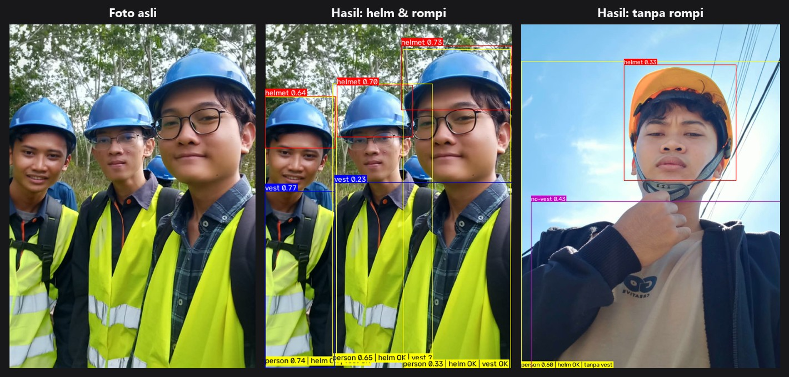
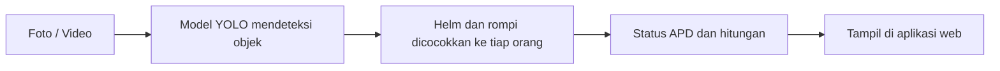

# 🦺 Safety Monitoring: Deteksi APD Pekerja Konstruksi

**Aplikasi berbasis AI yang memeriksa apakah pekerja memakai helm dan rompi keselamatan, dari foto maupun video.**


<!-- Setelah aplikasi online, tambahkan tautannya di sini: **[▶️ Coba demo](https://....streamlit.app)** -->



---

## 📌 Ringkasan Singkat

| | |
|---|---|
| **Masalah** | Pengawasan APD (Alat Pelindung Diri) secara manual melelahkan dan mudah terlewat. |
| **Solusi** | Model AI mengenali pekerja, helm, dan rompi, lalu menandai siapa yang belum lengkap. |
| **Hasil** | Skor deteksi (mAP50) **85%** pada 301 gambar validasi. |
| **Bentuk produk** | Aplikasi web yang bisa dipakai tanpa kemampuan pemrograman. |
| **Cakupan pekerjaan** | Penyiapan data, pelatihan model, evaluasi, pembuatan aplikasi, hingga persiapan deploy. |

---

## ✨ Fitur

**📷 Mode Gambar**
- Unggah foto sendiri atau pakai gambar contoh.
- Foto asli dan hasil deteksi tampil berdampingan.

**🎬 Mode Video**
- Pilih video contoh atau unggah video sendiri.
- Hasilnya diputar mulus **beserta suara**, dan bisa diunduh.
- Menampilkan **detik ke berapa** pelanggaran terjadi (tanpa helm atau tanpa rompi).

**⚙️ Mudah diatur**
- Tingkat keyakinan (*confidence*) bisa digeser sesuai kebutuhan.
- Setiap orang diberi status, contohnya `helm OK | tanpa vest`.
- Jumlah **Helm**, **Vest**, dan **Person** dihitung otomatis.

Warna kotak: 🟥 helm · 🟨 orang · 🟦 rompi · 🟧 tanpa helm · 🟪 tanpa rompi

---

## 📊 Performa Model

Diukur pada **301 gambar validasi** (1.981 objek).

| Ukuran | Nilai | Artinya |
|---|---|---|
| **Precision** | 80% | Dari semua yang ditandai model, sekitar 8 dari 10 benar. |
| **Recall** | 81% | Dari semua objek yang ada, sekitar 8 dari 10 berhasil ditemukan. |
| **mAP50** | 85% | Skor gabungan ketepatan deteksi (kecocokan kotak minimal 50%). |
| **mAP50-95** | 47% | Skor yang jauh lebih ketat soal presisi posisi kotak. |

**Rincian per kategori**

| Kategori | Precision | Recall | mAP50 | Catatan |
|---|---|---|---|---|
| 👷 Person | 93% | 92% | **95%** | Sangat baik |
| ⛑️ Helmet | 92% | 88% | **95%** | Sangat baik |
| 🦺 Vest | 88% | 83% | **91%** | Baik |
| ❌ No-vest | 74% | 76% | **80%** | Cukup |
| ❌ No-helmet | 54% | 65% | **65%** | Perlu ditingkatkan, contoh datanya sedikit |

---

## 🧠 Cara Kerja



---

## 🛠️ Tantangan dan Solusi

| Tantangan | Solusi |
|---|---|
| **Data tidak seimbang:** contoh *tanpa helm* hanya 89, sedangkan *person* 2.124. | Memberi **bobot kelas** saat pelatihan agar kategori yang jarang lebih diperhatikan. |
| **Risiko data bocor** antara data latih dan data uji membuat skor tampak lebih bagus dari kenyataan. | Memeriksa label yang identik di kedua kelompok data. Hasilnya **0 temuan**. |
| **Salah deteksi**, misalnya satu orang terbaca *pakai* dan *tidak pakai* rompi sekaligus. | Aturan pencocokan per orang: ambil hasil dengan skor tertinggi, abaikan APD di luar tubuh orang. |
| **Video patah-patah** di server cloud tanpa GPU. | Video **diproses dulu, baru diputar** dalam format yang didukung browser, lengkap dengan suara. |
| **Proses video lambat** jika setiap frame dideteksi. | Deteksi hanya beberapa kali per detik, tetapi video hasil tetap mulus. |
| **Ukuran instalasi besar** untuk server gratis. | Memakai PyTorch **versi CPU**. |

---

## 🔬 Detail Pelatihan

| Komponen | Keterangan |
|---|---|
| Model | YOLO26s (*pretrained*, dilatih ulang) |
| Dataset | 905 gambar latih dan 301 gambar validasi, dikelola di Roboflow |
| Kategori | `helmet`, `no-helmet`, `no-vest`, `person`, `vest` |
| Pengaturan | 30 epoch, ukuran gambar 800, batch 16, optimizer AdamW, *cosine learning rate* |
| Augmentasi | Mosaic, copy-paste, flip horizontal, variasi warna, random erasing |
| Perangkat | GPU NVIDIA Tesla T4 (Google Colab), sekitar 21 menit |

Prosesnya tercatat di [notebook pelatihan](src/safety_monitoring/train/Capstone_4_CV_Anwar_FINAL.ipynb).

---

## 🧰 Teknologi

**Python** · **Ultralytics YOLO** · **PyTorch** · **ONNX Runtime** · **OpenCV** · **Streamlit** · **FFmpeg** · **Poetry**

---

## 🚀 Cara Menjalankan

Butuh **Python 3.13** dan [Poetry](https://python-poetry.org/).

```bash
git clone https://github.com/ipul122/Safety_Monitoring.git
cd Safety_Monitoring
poetry install
poetry run streamlit run app.py
```

Aplikasi terbuka di `http://localhost:8501`.

**Deploy ke Streamlit Community Cloud:** pilih `app.py` sebagai file utama dan Python 3.13. Dependensi dibaca dari `requirements.txt` dan `packages.txt`.

---

## 📁 Struktur Proyek

```text
Safety_Monitoring/
├── app.py                 # Aplikasi Streamlit
├── images/                # Gambar contoh
├── videos/                # Video contoh
├── docs/                  # Gambar untuk dokumentasi
├── src/safety_monitoring/
│   ├── model/             # Model terlatih (best.pt, best.onnx) dan hasil pelatihan
│   └── train/             # Notebook pelatihan
├── pyproject.toml         # Dependensi (Poetry)
├── requirements.txt       # Dependensi (cloud)
└── packages.txt           # Pustaka sistem (cloud)
```

---

## ⚠️ Keterbatasan dan Rencana Pengembangan

**Keterbatasan saat ini**
- Deteksi *tanpa helm* masih lemah.
- Objek kecil, jauh, atau tertutup bisa terlewat.
- Jumlah dihitung per frame, belum melacak orang yang sama sepanjang video.
- Alat bantu pengawasan, **bukan pengganti** petugas K3.

**Rencana berikutnya**
- Menambah data *tanpa helm*.
- Pelacakan orang (*object tracking*) untuk laporan pelanggaran per individu.
- Notifikasi otomatis dan dukungan kamera CCTV langsung.

---

## 🙏 Sumber Video Contoh

Hak cipta milik pembuat masing-masing. Dipakai hanya untuk demonstrasi.

1. [Free PPE Safety Video for Construction Workers](https://www.youtube.com/watch?v=LL1e55Dnd_g)
2. [Construction Site CCTV (dd-security.co.uk)](https://www.youtube.com/watch?v=T40KkFDvHng)
3. [Kenapa Rompi Proyek Bisa Terlihat Menyala?](https://www.youtube.com/shorts/uKeRYHfQvyg)

---

## 👤 Pembuat

**Anwar** · Capstone Project Computer Vision · [GitHub](https://github.com/ipul122)
